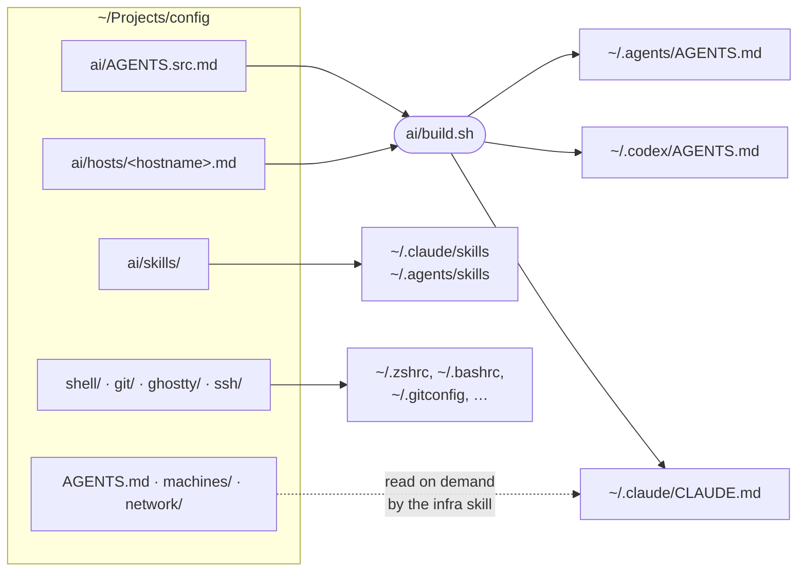

<div align="center">

# config-template

**A starter kit for one private repo that sets up all your machines<br>and teaches your AI agents how they fit together.**

Dotfiles · agent instructions and skills · infrastructure notes · one install script

[](https://github.com/danjdewhurst/config-template/actions/workflows/check.yml)
[](LICENSE)


[**Use this template**](https://github.com/danjdewhurst/config-template/generate) · [Quick start](#quick-start) · [Make it yours](#make-it-yours) · [How it works](#how-it-works)

</div>

---

Most dotfiles repos stop at your shell. This one also gives your AI coding agents a map: what machines you have, how to reach them, what they may touch, and how you like to work. Write it down once, and every agent on every machine reads the same thing.

<table>
<tr>
<td width="33%" valign="top">

### 🗂️ Dotfiles
bash, zsh (prezto), tmux, git, Ghostty and SSH config, linked into `$HOME`. Edit `~/.zshrc` and you edit the repo.

</td>
<td width="33%" valign="top">

### 🤖 Agent config
One `AGENTS.src.md` rendered for Claude Code, Codex and `~/.agents`, with per-agent blocks, per-machine notes and shared skills.

</td>
<td width="33%" valign="top">

### 🗺️ Infra notes
`AGENTS.md` plus a file per machine and network, in a format agents read well, with rules they follow before touching a server.

</td>
</tr>
</table>

## Quick start

1. Click [**Use this template**](https://github.com/danjdewhurst/config-template/generate) and create your copy. **Make it private.** It will hold your hostnames, IPs and network layout.
2. Clone it and run the installer:

   ```sh
   git clone git@github.com:<you>/config.git ~/Projects/config
   ~/Projects/config/install.sh
   ```

3. Work through [Make it yours](#make-it-yours), commit, and push. On each other machine, clone and run `install.sh` too.

You need bash, git, and a package manager: [Homebrew](https://brew.sh) on macOS, or apt, dnf or pacman on Linux. Linux also needs `sudo` and `curl`.

> [!TIP]
> `install.sh` is safe to re-run. When everything is in place, it changes nothing. Anything it would replace is moved to `<name>.bak` first.

## Make it yours

The template is full of examples. Replace them with your own:

- [ ] **`git/gitconfig`**: your name and email. The installer warns until you do.
- [ ] **`install.conf`**: flags for the `claude` alias, an optional NextDNS profile, the clipboard server.
- [ ] **`ai/AGENTS.src.md`**: how you want agents to reply and work. Start from the examples, then cut.
- [ ] **`ai/hosts/`**: rename `my-laptop.md` and `my-server.md` to your hostnames (`hostname -s`).
- [ ] **`AGENTS.md`**: your machines, how to reach them, and the rules for agents.
- [ ] **`machines/`, `network/`**: one note per machine, and your network. Fill them from the real thing.
- [ ] **`ai/skills/infra/SKILL.md`**: list your machine and domain names in its description.
- [ ] **`ssh/config`**, **`macos/Brewfile`**: your hosts and your packages.
- [ ] **`scripts/refresh.sh`**: set `HOSTS` and `DOMAINS`.

Then run `install.sh` again, and ask your agent "what machines do I have?" to check it found the map.

## How it works



In order, `install.sh`:

1. Renders the agent instructions in `ai/`, once per agent, with this machine's host note at the end.
2. Links the config files below into `$HOME`.
3. Links the instructions into `~/.claude`, `~/.codex` and `~/.agents`, and each skill in `ai/skills/` into `~/.claude/skills` and `~/.agents/skills`.
4. On macOS, clones [prezto](https://github.com/sorin-ionescu/prezto), installs what's missing from `macos/Brewfile`, and loads the clipboard image server.
5. Installs the CLI tools agents lean on: `git`, `rg`, `fd`, `jq`, `gh`, `git-lfs`, `tmux`, `mise`, `ast-grep` and `yq`. Sets gh to use expiring tokens.
6. Installs [bun](https://bun.sh), then the skills listed in `ai/skills.txt` with the [skills CLI](https://skills.sh).
7. Points Claude Code's Bash tool at bash 4+ and turns off its auto memory in `~/.claude/settings.json`. Every other key is left alone.

### What gets linked

| Repo file | Linked to | Where |
|---|---|---|
| `shell/bashrc` | `~/.bashrc` | Everywhere |
| `shell/tmux.conf` | `~/.tmux.conf` | Everywhere |
| `git/gitconfig` | `~/.gitconfig` | Everywhere |
| `git/ignore` | `~/.config/git/ignore` | Everywhere |
| `shell/zsh/*` | `~/.zshrc`, `~/.zshenv`, `~/.zprofile`, `~/.zpreztorc` | macOS |
| `ghostty/` | `~/.config/ghostty/` | macOS |
| `ssh/config` | `~/.ssh/config` | macOS |
| `clipboard/xclip` | `~/.local/bin/xclip` | Linux |

macOS is treated as your desktop and Linux as headless servers. Change `LINKS` in `install.sh` if that's not you.

## Highlights

- **One source, many agents.** Write instructions once. Wrap a block in `<claude>` or `<codex>` to send it to one agent only. A typo in a tag fails the build instead of silently dropping text. [More](ai/README.md)
- **Per-machine context.** `ai/hosts/<hostname>.md` tells the agent where it is: "this box is headless, don't give me `localhost` links, use Tailscale Serve".
- **A map with rules.** `AGENTS.md` tells agents to check the live system before trusting the notes, to ask before changing a server, and to keep the notes current.
- **Claude Code gets a real bash.** A minimal `bashrc` with Homebrew and mise on PATH, kept apart from your interactive zsh. [Why](shell/README.md)
- **Paste screenshots over SSH.** Ctrl+V in Claude Code on a Linux box pastes the image on your Mac's clipboard. [How](clipboard/README.md)
- **Safety nets.** CI runs shellcheck and a [gitleaks](https://github.com/gitleaks/gitleaks) scan of the full history on every push, and `.gitignore` blocks keys and `.env` files.

## Day to day

| To | Do this |
|---|---|
| Change a dotfile | Edit it in place (it's a link), then commit and push |
| Change the agent instructions | Edit `ai/AGENTS.src.md`, then run `ai/build.sh` |
| Add a skill | Add a folder to `ai/skills/`, or a line to `ai/skills.txt`, then re-run `install.sh` |
| Update installed skills | `bunx skills update -g` |
| Sync another machine | `git pull && ./install.sh` |
| Override a setting on one machine | `~/.ai-config.local`, `~/.bashrc.local`, `~/.zshrc.local`, `~/.gitconfig.local` |
| Check the notes against reality | `scripts/refresh.sh` |

## Layout

```text
.
├── AGENTS.md            the map agents read first
├── install.sh           sets up a machine, safe to re-run
├── install.conf         your choices for install.sh
├── ai/                  agent instructions, host notes, skills, build.sh
├── machines/            one note per machine
├── network/             Tailscale, DNS
├── shell/               bashrc, tmux.conf, zsh/
├── git/                 gitconfig, global ignore
├── ghostty/             terminal config and theme
├── ssh/                 desktop SSH config
├── macos/               Brewfile
├── clipboard/           image paste over SSH
├── scripts/refresh.sh   read-only snapshot of the live setup
└── .github/workflows/   shellcheck + gitleaks
```

## Good to know

- **Keep your copy private, and keep secrets out of it anyway.** Hostnames and IPs are fine in a private repo. Passwords, keys and tokens are not.
- `~/.bashrc` is replaced, not merged. On Ubuntu that drops the distro's default prompt and history settings. The original is kept as `~/.bashrc.bak`.
- Homebrew skips packages from taps you haven't trusted. Mark third-party entries in the Brewfile with `trusted: true`.
- On Linux, `ast-grep` and `yq` come from mise, since distro package managers don't carry them. Debian calls `fd` `fdfind`, so the script adds an `fd` link in `~/.local/bin`.
- Some installs pipe a remote script into a shell: mise (without Homebrew) from `mise.run`, and bun from `bun.sh`.

## Credits

The zsh runcoms are based on [prezto](https://github.com/sorin-ionescu/prezto) by Sorin Ionescu. The Ghostty theme is [Catppuccin Frappé](https://github.com/catppuccin/ghostty).

## License

[MIT](LICENSE) © 2026 Dan Dewhurst
